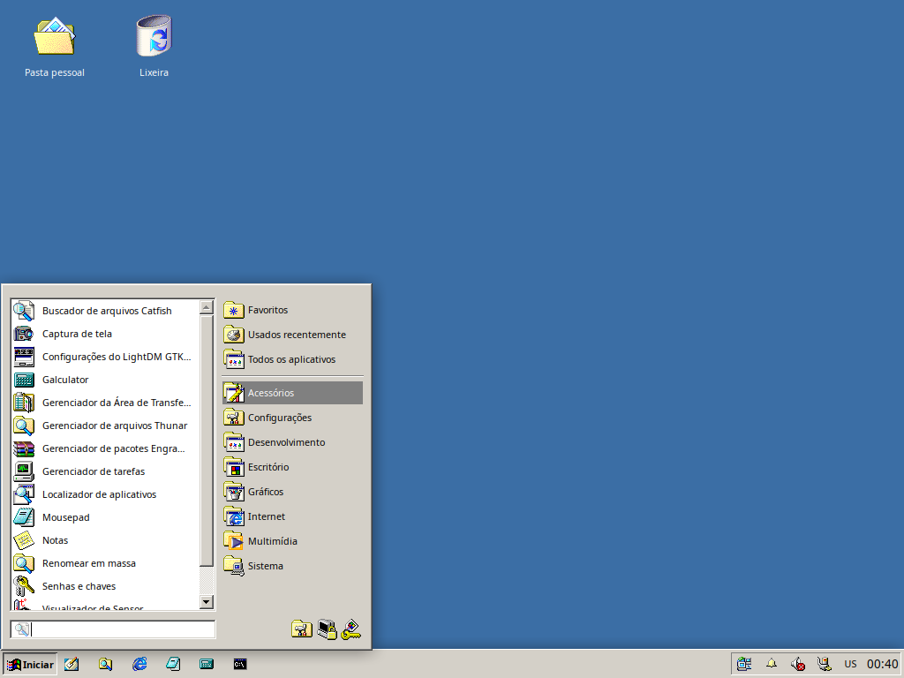
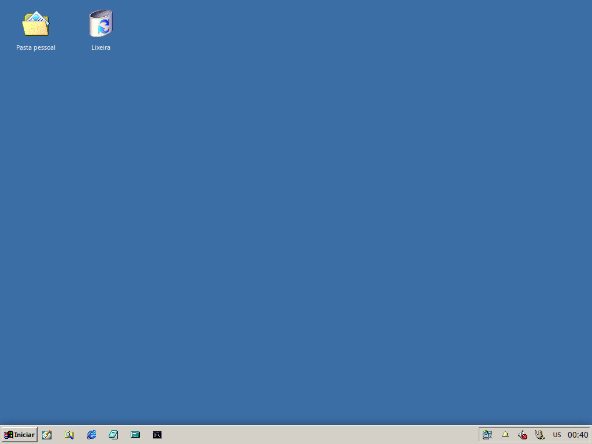
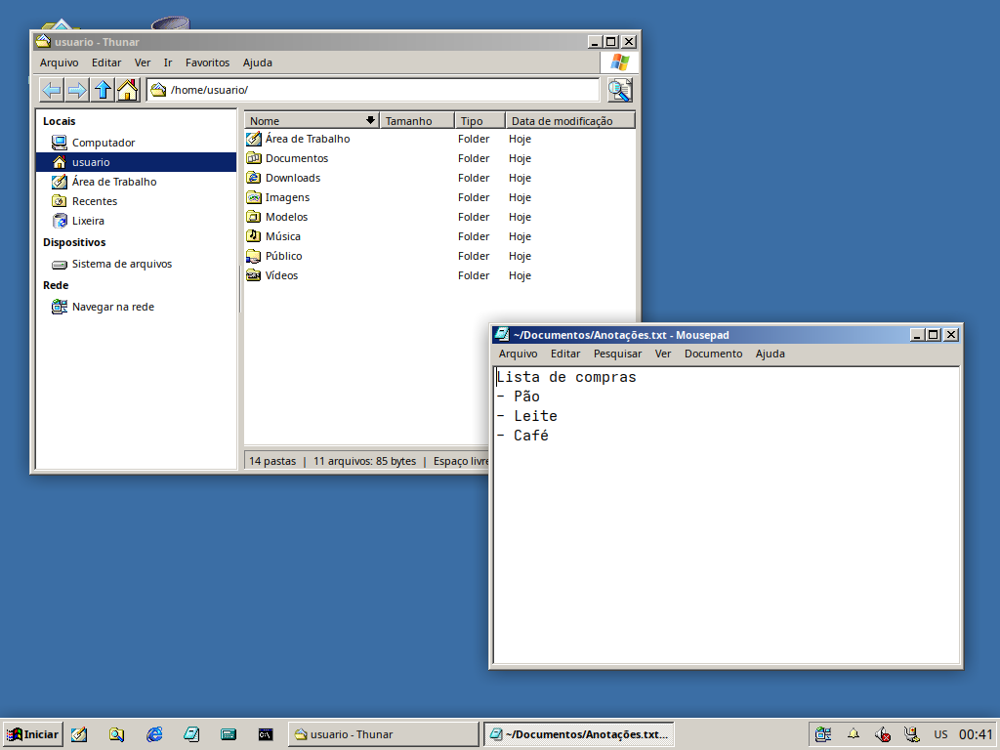
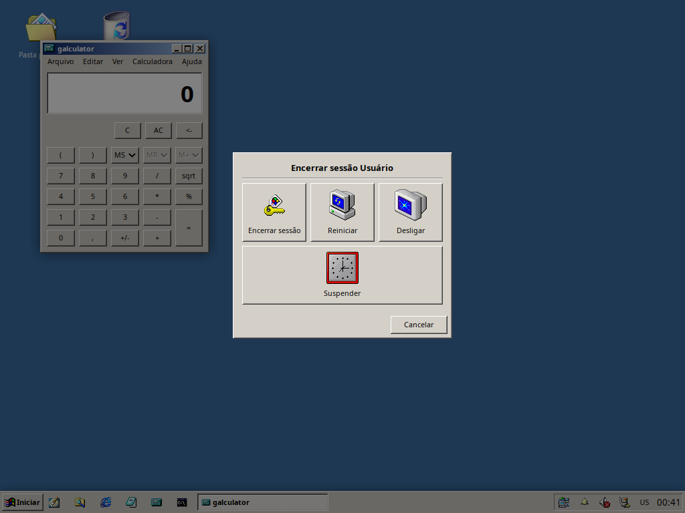
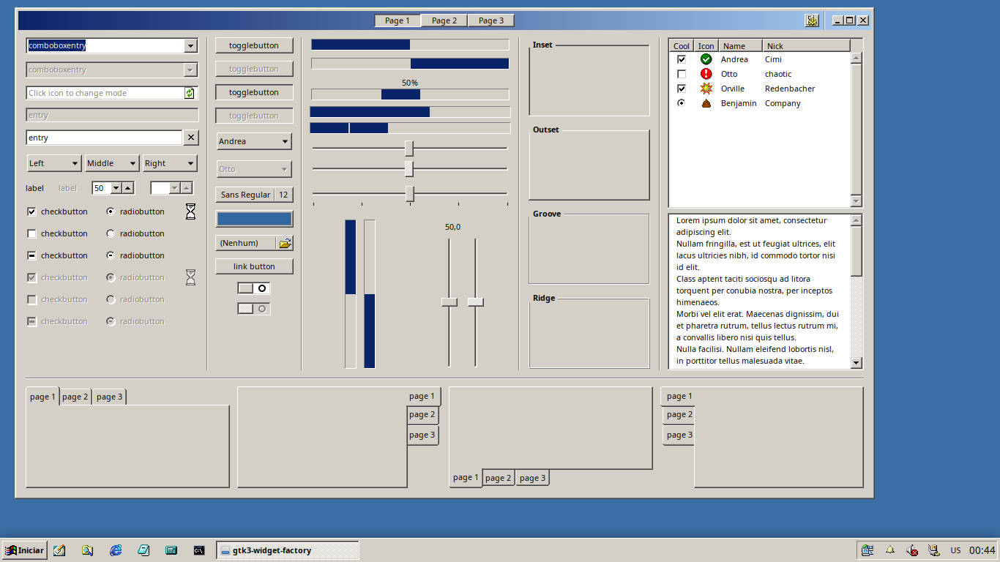
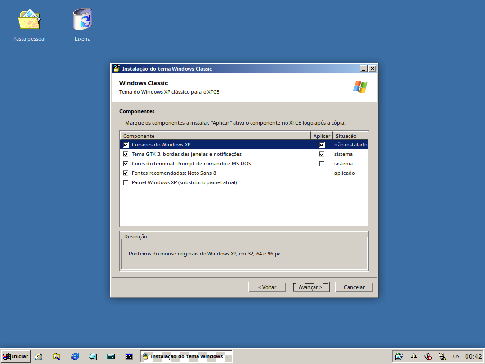
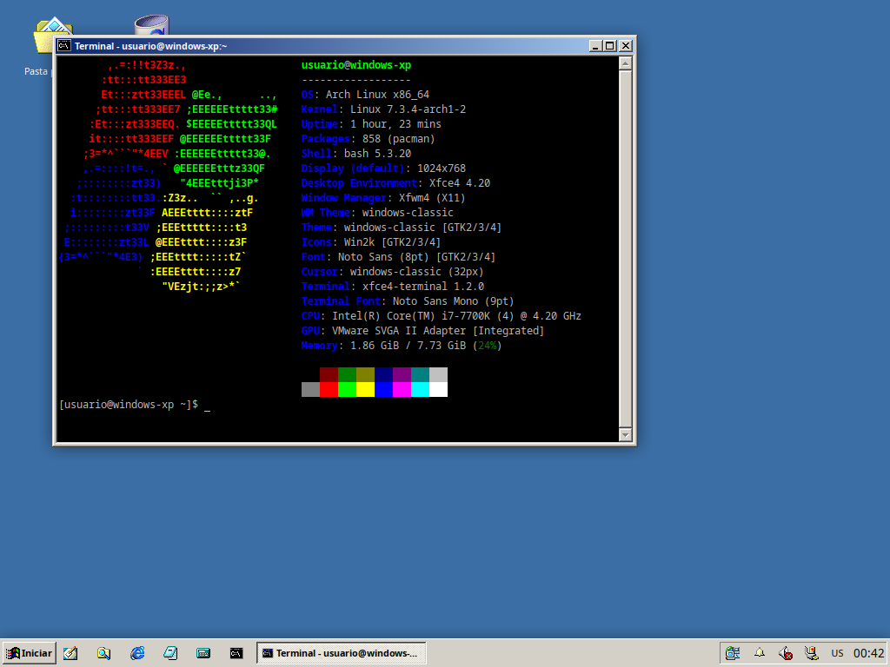
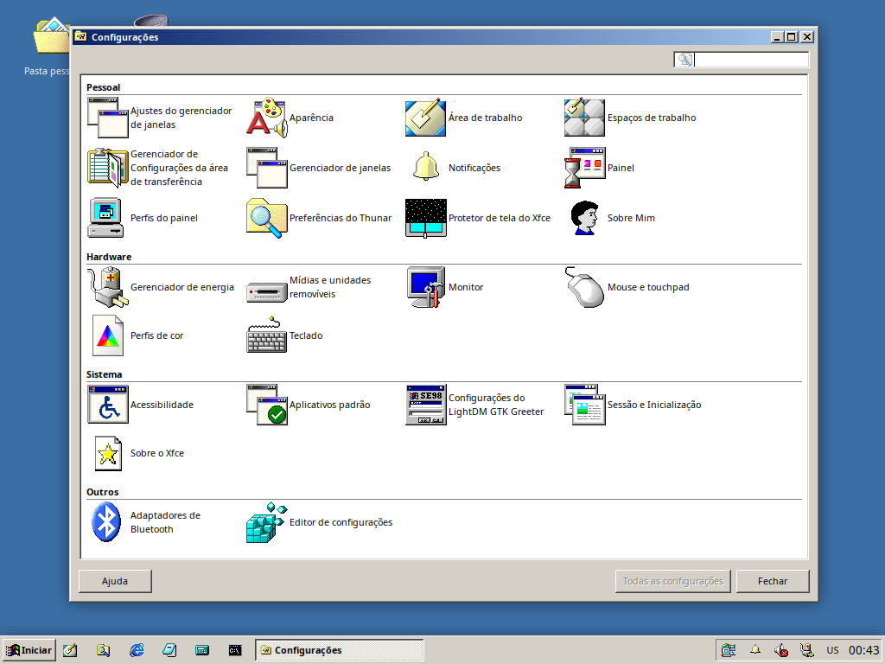
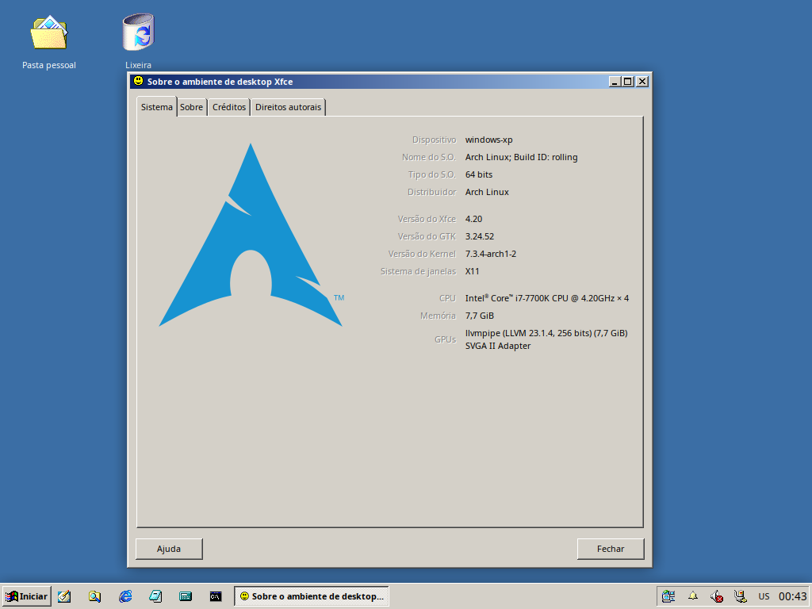
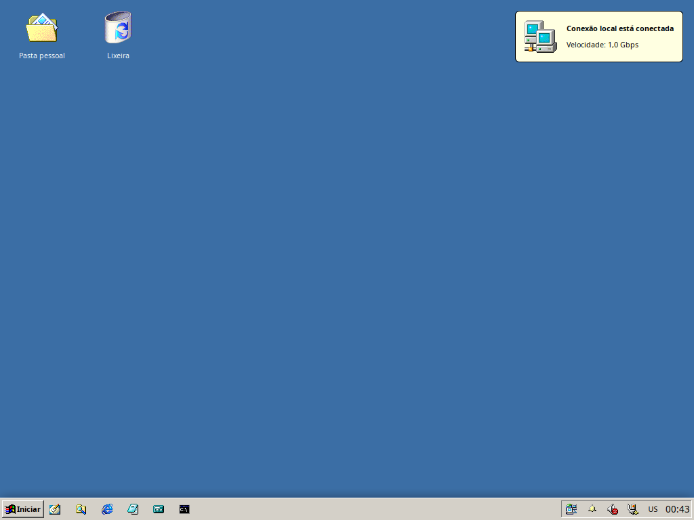

# Windows Classic para XFCE

Tema completo para XFCE que reproduz, o mais fielmente possível, o tema
clássico do Windows XP.



## Capturas de tela

| | |
|---|---|
|  |  |
| Área de trabalho e barra de tarefas | Menu Iniciar (Whisker Menu) com Acessórios |
|  |  |
| Thunar e Mousepad | Galculator e o diálogo de encerrar sessão |
|  |  |
| Widgets GTK3 (gtk3-widget-factory) | Assistente de instalação |
|  |  |
| Terminal com `fastfetch --logo windows` (cores do Prompt de comando) | Gerenciador de configurações |
|  |  |
| Sobre o ambiente de desktop Xfce | Notificação no estilo dos balões do XP |

Nas capturas: tema GTK, bordas e cursores **Windows Classic**, fontes Noto Sans 8,
painel do perfil `Panel/windows-classic.tar.bz2`, fundo em cor sólida `#3B6EA5`
(o azul da área de trabalho do XP clássico) e o tema de ícones
[Win2k](https://github.com/SmileYzn/win2k), que não faz parte deste projeto.

## Estrutura

| Pasta | Conteúdo | Situação |
|-------|----------|----------|
| `Cursors/windows-classic-cursors` | Tema de cursores X11 | ✅ pronto |
| `Theme/windows-classic/xfwm4` | Bordas das janelas (xfwm4) | ✅ pronto |
| `Theme/windows-classic-xhdpi/xfwm4` | Bordas em 2x para HiDPI (gerado) | ✅ pronto |
| `Theme/windows-classic/gtk-3.0` | Tema GTK 3 | ✅ pronto |
| `Icons/windows-classic-icons` | Tema de ícones (freedesktop) | 🚧 em andamento |
| `Terminal` | Esquemas de cores do xfce4-terminal | ✅ pronto |
| `Setup` | Instalador (assistente e linha de comando) | ✅ pronto |
| `Panel` | Perfil do painel do XFCE (xfce4-panel-profiles) | ✅ pronto |
| `Screenshots` | Capturas de tela usadas neste README | — |

## Instalação

O instalador fica em `Setup/`: um assistente no estilo dos assistentes do
Windows XP, que instala, atualiza e remove o tema.

```bash
sudo pacman -S --needed python-gobject gtk3 polkit
python3 Setup/windows-classic-installer.py
```

Passos: tipo de instalação (instalar ou remover; **somente para mim**, na pasta
pessoal, ou **todos os usuários**, em `/usr/share`, com a senha de administrador
pelo `pkexec`) e componentes. Tudo o que o tema usa já vem pronto no projeto.
Na conclusão, o assistente oferece reiniciar o computador, como o Setup do
Windows.

| Componente | O que faz | "Aplicar" no XFCE |
|---|---|---|
| Cursores do Windows XP | copia `Cursors/windows-classic-cursors` | tema de cursores, 32 px (64 px na escala 2x) |
| Tema GTK 3, bordas e notificações | copia `windows-classic` e `windows-classic-xhdpi` | tema GTK, xfwm4 (normal ou HiDPI), notificações opacas, "Realce de arquivos" do Thunar desligado |
| Cores do terminal | copia os esquemas de `Terminal/` | (desmarcado por padrão) cores do Prompt de comando no Xfce Terminal |
| Fontes recomendadas | — | Noto Sans 8 e Noto Sans Bold 8 nos títulos |
| Painel Windows XP (desmarcado por padrão) | — | carrega `Panel/windows-classic.tar.bz2` no lugar do painel atual |

O instalador não faz backup: ao instalar, substitui o que houver com o mesmo
nome; ao remover, apaga os arquivos e as configurações dos componentes voltam
ao padrão do XFCE. O painel não é alterado na remoção (para trocar de layout,
use **Configurações → Painel** ou o `xfce4-panel-profiles`).

Também funciona no terminal:

```bash
python3 Setup/windows-classic-installer.py --list
python3 Setup/windows-classic-installer.py --install all
python3 Setup/windows-classic-installer.py --install all --with-panel
python3 Setup/windows-classic-installer.py --install all --system
python3 Setup/windows-classic-installer.py --uninstall all
```

## Cursores

Os cursores são os **originais do esquema padrão do Windows XP**, já prontos
em `Cursors/windows-classic-cursors/` (32, 64 e 96 px). Foram extraídos da pasta `I386`
de um CD do Windows XP:

- `USER32.DLL`: seta, texto, ocupado, segundo plano, ajuda, mira, caneta,
  mão, proibido, redimensionar, mover, seta para cima e rolagem (botão do meio);
- `OLE32.DLL`: arrastar, copiar, criar atalho e "não pode soltar".

O Xcursor não tem pixels que "invertem" a cor da tela, como o cursor de
texto e a mira do Windows. Esses pixels viram preto com contorno branco,
para continuarem visíveis em qualquer fundo.

### Gerar de novo (desenvolvimento)

Só é preciso para mudar os cursores. A partir da pasta I386:

```bash
sudo pacman -S --needed python cabextract icoutils xorg-xcursorgen
python3 Cursors/src/build.py /caminho/para/I386
```

O resultado vai para `Cursors/windows-classic-cursors/`, com uma prévia em
`Cursors/build/preview.png`.

Também é possível ativar manualmente em
**Configurações → Mouse e touchpad → Tema**, escolhendo *Windows Classic*.
Para telas HiDPI, use o tamanho 64.

## Bordas das janelas (xfwm4)

No esquema **Windows Clássico** do XP:

- barra de título com degradê do azul `#0A246A` ao `#A6CAF0`
  (inativa: `#808080` → `#C0C0C0`) ocupando a largura toda;
- 23 px do topo da moldura até a área da janela (4 + 18 + 1), como no XP;
- moldura 3D com `#D4D0C8`, `#FFFFFF`, `#808080` e `#404040`;
- botões de 16×14 px, com 2 px de margem também na janela maximizada.

O tema é otimizado para a fonte **Noto Sans** (título em *Noto Sans Bold 8*,
equivalente ao Tahoma 8 negrito do XP; veja [Fontes](#fontes)). O instalador já configura a fonte
do título; para fazer manualmente:

```bash
sudo pacman -S --needed noto-fonts
xfconf-query -c xfwm4 -p /general/theme -s windows-classic
xfconf-query -c xfwm4 -p /general/title_font -s "Noto Sans Bold 8"
```

### HiDPI (escala 2x)

No xfwm4 as variantes HiDPI são temas separados (como o `Default-xhdpi` do
próprio XFCE). Com a escala de janelas em 2x
(**Configurações → Aparência → Configurações → Escala de janelas**), escolha
**windows-classic-xhdpi** em **Configurações → Gerenciador de janelas →
Estilo**. O instalador já faz essa escolha automaticamente.

O tema `windows-classic-xhdpi` é gerado a partir do `windows-classic/xfwm4`
(ampliação 2x pixel a pixel, mantendo o visual nítido). Depois de alterar
algo em `Theme/windows-classic/xfwm4`, gere de novo:

```bash
python3 Theme/src/gerar-xhdpi.py
```

## Tema GTK 3

No esquema **Windows Clássico** do XP, com as cores do arquivo de tema oficial
do XP (`I386/CLASSIC.TH_`). A sombra escura das bordas 3D (ButtonDkShadow) é
`#404040`; os desenhos (setas, marcas, "X") e o contorno do botão padrão
(WindowFrame) são pretos.

O `Theme/src/adaptar-gtk3-xp.py` garante essas cores nas imagens e gera as
caixinhas "+/−" das árvores (veja abaixo). Depois de mudar imagens do tema,
rode de novo:

```bash
python3 Theme/src/adaptar-gtk3-xp.py
```

As medidas do XP ficam em `Theme/windows-classic/gtk-3.0/xp.css`, importado
por último, conferidas com as métricas do XP clássico:

| Item | XP clássico |
|------|-------------|
| Barra de menus | 19 px (`SM_CYMENU`) |
| Item de menu | 18 px; separador de 9 px com linha 3D |
| Item aberto da barra de menus | rebaixado, texto preto (menus não planos) |
| Borda dos menus | relevo 3D, também sem compositor |
| Áreas brancas | `#FFFFFF` |
| Polegar da barra de rolagem | borda 3D exata no pixel (16 px) |

### Imagens do Windows XP

A marca do Explorer (bandeira em fundo branco, 50 quadros, da `shell32.dll` do
XP) já vem pronta em `gtk-3.0/assets` (`status_badge_xp.png` e `throbber/`). No
Thunar, a bandeira fica numa caixa branca de 39×22 px na ponta da barra de menus,
como no Explorer clássico, e tremula enquanto uma pasta carrega. Para extrair de
novo (desenvolvimento):

```bash
sudo pacman -S --needed cabextract icoutils imagemagick
python3 Theme/src/extrair-xp.py /caminho/para/I386
```

(o instalador já faz isso na primeira instalação).

### Só XFCE

O tema é feito só para o XFCE (xfwm4 + GTK3), sem ajustes para outros ambientes
(MATE, Cinnamon, GNOME).

### Seleção de ícones no Thunar

Como no Explorer do XP: o nome selecionado tem fundo azul `#0A246A` e texto
branco, só atrás do texto e com cantos retos, e o ícone fica tingido de azul.
Com a janela inativa, o nome fica cinza (`#D4D0C8`) com texto preto e o ícone
volta ao normal.

Isso exige o **"Realce de arquivos" do Thunar desligado** (com ele ligado, o
Thunar desenha no próprio código um retângulo azul arredondado sobre o ícone e o
nome). O instalador já desliga; para fazer manualmente, use o menu
**Ver → Mostrar realce de arquivo** ou:

```bash
xfconf-query -c thunar -p /misc-highlighting-enabled -n -t bool -s false
```

Diferenças que ficam: o XP mistura o ícone 50% com o azul e o Thunar multiplica
(as cores ficam próximas, não idênticas); e, com a janela ativa, o nome continua
azul mesmo quando o foco está no painel lateral (no XP ficaria cinza).

### Notificações (xfce4-notifyd)

`Theme/windows-classic/xfce-notify-4.0/gtk.css` dá às notificações as cores e a
borda dos balões do XP: fundo `#FFFFE1`, texto preto, borda preta de 1 px com
cantos arredondados e título em negrito. Tamanhos e posições (ícone, título,
texto, botões) seguem o padrão do XFCE. O instalador ativa o tema e deixa as
notificações opacas; para fazer manualmente, use **Configurações → Notificações**
ou:

```bash
xfconf-query -c xfce4-notifyd -p /theme -n -t string -s windows-classic
xfconf-query -c xfce4-notifyd -p /initial-opacity -n -t double -s 1.0
xfconf-query -c xfce4-notifyd -p /notify-location -n -t uint -s 3   # canto inferior direito, como no XP
```

O xfce4-notifyd não tem botão "X" de fechar (a notificação fecha com um clique)
e, sem compositor, os cantos ficam retos.

### Terminal (xfce4-terminal)

A pasta `Terminal/` tem dois esquemas de cores, instalados pelo instalador:

| Esquema | Texto / fundo | Paleta |
|---|---|---|
| Prompt de comando (Windows XP) | `#C0C0C0` / `#000000` | 16 cores do console do XP (`#800000`, `#008000`, `#000080`...) |
| MS-DOS (VGA) | `#AAAAAA` / `#000000` | 16 cores do modo texto VGA (`#AA0000`, `#AA5500` marrom...) |

Para usar: xfce4-terminal → Editar → Preferências → Cores → Predefinições.

### Painel (barra de tarefas)

O perfil `Panel/windows-classic.tar.bz2` (componente "Painel Windows XP" do
instalador) monta a barra de tarefas: botão **Iniciar** (Whisker Menu),
"Mostrar a área de trabalho" e Inicialização rápida (navegador, arquivos,
Mousepad, Galculator e terminal), lista de janelas, área de notificação, volume,
energia, teclado e relógio, com 30 px de altura. Precisa do
`xfce4-panel-profiles` e dos plugins usados:

```bash
sudo pacman -S --needed xfce4-panel-profiles xfce4-whiskermenu-plugin \
    xfce4-pulseaudio-plugin xfce4-notifyd xfce4-power-manager xfce4-xkb-plugin galculator
```

Para carregar à mão: `xfce4-panel-profiles load Panel/windows-classic.tar.bz2`.

O painel imita a barra de tarefas **travada** do XP: sem alças nem linhas, com
8 px entre o botão Iniciar e o primeiro ícone da Inicialização rápida e 15 px
entre o último ícone e o primeiro botão de tarefa (`apps/xfce-panel-hacks.css`).

Mantenha o painel travado (Preferências do painel → "Travar o painel"). Destravado,
o xfce4-panel desenha alças pontilhadas nas pontas direto no código, e o tema
não consegue mudá-las nem escondê-las.

### Caixinhas "+/−" das árvores

As caixinhas são desenhadas como no Explorer do XP (9×9 px, borda `#808080`,
fundo branco, sinal preto) em `assets/treeview-*.png`.

No GTK3, imagens via `url()` são esticadas até a altura da linha da árvore e
ficam borradas; só ícones de tema de ícones são desenhados no tamanho real e
centralizados. Por isso as imagens vão empacotadas em `gtk-3.0/gtk.gresource`,
que o GTK3 carrega junto com o tema: os recursos em `/org/gtk/libgtk/icons/`
contam como ícones, e o CSS os pede por nome (`-gtk-icontheme(...)`). Nada é
instalado fora do tema. O `adaptar-gtk3-xp.py` gera o `gtk.gresource`
(precisa do `glib-compile-resources`, do pacote `glib2`).

### Barra de rolagem sempre visível

O GTK3 esconde as barras de rolagem (modo "overlay") e isso não pode ser
mudado pelo tema, só pela variável de ambiente `GTK_OVERLAY_SCROLLING=0`.
O `testar.sh` já a usa. Para a sua sessão, por exemplo:

```bash
echo 'export GTK_OVERLAY_SCROLLING=0' >> ~/.xprofile
```

## Ícones (windows-classic-icons)

Tema de ícones no padrão freedesktop, com os ícones originais do Windows XP
(16, 24, 32 e 48 px), herdando do Adwaita e do hicolor o que ainda não tem.
Cobre 162 dos 264 nomes padrão da Icon Naming Specification e 51 dos 57 ícones
pedidos pelos aplicativos instalados (contados pelo `Icons/mapa.py`).

O tema é montado a partir de uma lista, `Icons/windows-classic-icons.list`
(separada por TAB: `contexto/nome`, origem, tamanhos e observação; a origem é
`xp:<nome>` (galeria `Icons/xp-icons`) ou o caminho de um arquivo seu):

```bash
python3 Icons/mapa.py                               # Icons/mapa.html: o que falta e a galeria XP
python3 Icons/aplicar-lista.py                      # refaz o tema a partir da lista
```

A galeria tem os ícones de 127 arquivos do XP (DLLs, executáveis, painéis de
controle e arquivos dentro do `SP3.CAB`, do `DRIVER.CAB` e do `MMSSETUP.CAB`) e
os botões das barras de ferramentas do Explorer e do Internet Explorer
(`shell32.dll-barras`). As linhas com a observação `auto` foram mapeadas
automaticamente e podem ser revisadas no `mapa.html`.

## Fontes

O tema foi medido e testado com a **Noto Sans**, no lugar da Tahoma do XP. As
alturas dos menus, a barra de título e as demais medidas conferidas com o XP
valem para estas fontes, a 96 DPI:

| Uso | Fonte | Onde configurar |
|-----|-------|-----------------|
| Interface (menus, botões, listas, rótulos) | **Noto Sans 8** | Configurações → Aparência → Fontes |
| Título das janelas (xfwm4) | **Noto Sans Bold 8** | Configurações → Gerenciador de janelas → Estilo |
| Fonte de largura fixa (terminal, editores) | Noto Sans Mono 9 (ou outra monoespaçada) | Configurações → Aparência → Fontes |
| DPI | **96** | Configurações → Aparência → Fontes → DPI personalizado |

Instalação (Arch Linux) e configuração (o instalador já configura a fonte da
interface e a do título):

```bash
sudo pacman -S --needed noto-fonts
xfconf-query -c xsettings -p /Gtk/FontName -s "Noto Sans 8"
xfconf-query -c xfwm4 -p /general/title_font -s "Noto Sans Bold 8"
xfconf-query -c xsettings -p /Xft/DPI -n -t int -s 96
```

### Outras fontes e outros tamanhos

- **Tamanhos maiores:** a parte GTK acompanha a fonte. As medidas em px do CSS
  são mínimos, então os widgets crescem com o texto. O que **não** acompanha:
  - a barra de título do xfwm4, que tem altura fixa de 18 px nas imagens, como no
    XP, e a posição do texto ajustada para Noto Sans Bold 8 (o título passa a ficar
    descentralizado ou cortado);
  - o texto do botão "Iniciar" (11 px fixos em `gtk.css`) e o título das barras
    desenhadas pelos próprios aplicativos (8 pt fixos em `gtk-window.css`);
  - medidas copiadas do XP em px, como no Windows: separadores de menu, barra de
    rolagem, espaçamentos do painel e caixa da bandeira no Thunar.
- **Tahoma 8** (a fonte original do XP, extraída da sua mídia: `TAHOMA.TT_` e
  `TAHOMABD.TT_` na I386): **não testada** com este tema. A posição do título no
  xfwm4 e as alturas medidas foram ajustadas para a Noto Sans e podem ficar
  1–2 px diferentes. Ela não vem no projeto.
- **Terminal no estilo do MS-DOS:** para os esquemas de cores de `Terminal/`, uma
  fonte bitmap livre parecida com a do console é a "Px437 IBM VGA" (Oldschool PC
  Font Pack, int10h.org).

## Testes

O `testar.sh` abre uma sessão XFCE dentro de uma janela Xephyr usando os
cursores e o tema direto desta pasta (fontes Noto Sans), sem instalar nada e
sem alterar suas configurações:

```bash
sudo pacman -S --needed xorg-server-xephyr
./testar.sh                  # ou ./testar.sh 1280x800
./testar.sh 1920x1080 2      # sessão HiDPI (escala 2x)
```

## Licença

GPL-3.0 (veja `LICENSE`).

Créditos: os temas xfwm4 e GTK 3 derivam do
[Win2k](https://github.com/SmileYzn/win2k) (SmileYzn), que deriva do
Chicago95 (Grassmunk, AdrianoML, EMH-Mark-I). O tema não depende de nenhum
arquivo deles: tudo o que usa está neste repositório.

Os cursores e as imagens da marca do Explorer foram extraídos do Windows XP
(Microsoft).
